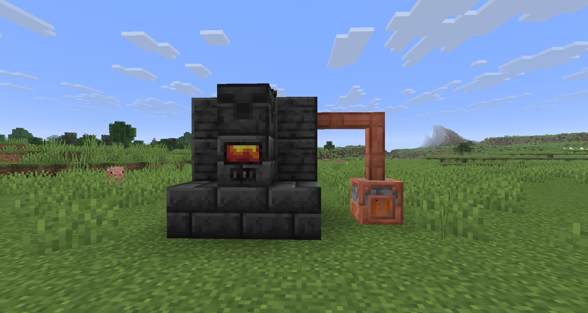

# Burning ⨯ Alloy Forgery

Compatibility patch between [**Burning**](https://github.com/un-nubivago/burning)-based mods (e.g., [**Heater**](https://github.com/un-nubivago/heater)) and [**Alloy Forgery**](https://github.com/wisp-forest/alloy-forgery).

_(Showcase using a **Heater** from the homonymous mod to channel heat through a **Heat Pipe** from that same mod into the frame of a **Forge**'s frame)_
